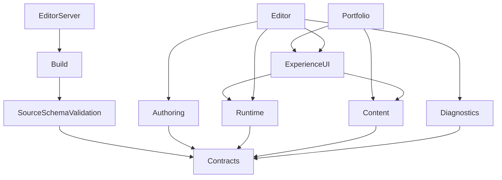

# Production architecture

This is a fresh workspace. Neither historical application is its implementation foundation.

For an explanation of the names, practical examples and guidance on where new code belongs, read [How to understand and extend this project](architecture-guide.md).

## Documentation authority

Accepted ADRs in [decisions/](decisions/) and this architecture specification are the normative architectural sources. [architecture-guide.md](architecture-guide.md) is explanatory. The [production roadmap](production-roadmap.md), [progress tracker](progress-tracker.md), and [first vertical slice](first-vertical-slice.md) describe sequencing, status, and planned scope.

If explanatory or planning documentation conflicts with an accepted architectural decision, the accepted ADR and architecture specification take precedence. A planned experiment or an ADR marked NEEDS EXPERIMENT does not override an accepted decision; architectural changes require a deliberately accepted decision and corresponding specification update.

## Applications and packages

| Member            | Responsibility                                                  | Allowed internal dependencies                                                                                      | Public delivery                      |
| ----------------- | --------------------------------------------------------------- | ------------------------------------------------------------------------------------------------------------------ | ------------------------------------ |
| apps/portfolio    | Fast independent DOM website; future lazy experience host       | contracts, experience-ui, portfolio-content                                                                        | Website client/server output         |
| apps/editor       | Authoring UI, session/viewport adapters, future iframe Play     | contracts, world-authoring, runtime, experience-ui, portfolio-content, diagnostics; world-build only in src/server | Never in portfolio deployment        |
| contracts         | Framework-independent public runtime/data/observation contracts | None                                                                                                               | Only necessary values; types erase   |
| world-authoring   | Source schemas, validation and isolated editing interfaces      | contracts                                                                                                          | Never                                |
| world-build       | Offline preparation boundary                                    | contracts; world-authoring/schema and /validation only                                                             | Never; editor server/build jobs only |
| runtime           | Production implementation behind WorldRuntime                   | contracts                                                                                                          | Future lazy production runtime       |
| experience-ui     | Shared production DOM/runtime host                              | contracts, runtime facade, portfolio-content                                                                       | Future lazy experience UI            |
| portfolio-content | Content identity and future shared DOM content                  | contracts                                                                                                          | Required content only                |
| diagnostics       | External development observations and future analysis           | contracts                                                                                                          | Never                                |

All application packages are private deployment roots. No package may depend on an app. Tool configuration remains under tools/config rather than creating more workspace packages.

## Dependency direction

The implemented allowlist is `tools/checks/policy.mjs`. Static scanning checks every active source import, including type imports, re-exports and literal dynamic imports. Computed imports, source symlinks, absolute source imports, undeclared dependencies, unexported entries and relative cross-package imports are rejected. Dependency-cruiser adds source-cycle checks. No reference directory is traversed as an active source root.

This is accidental-coupling protection, not a security sandbox against intentionally malicious code. Changes to loaders, package exports, aliases, Next configuration or production input roots must update and test policy. Future client/server adapters must preserve the current conservative rule: editor code outside src/server cannot import that directory. Introduce an explicitly reviewed server endpoint boundary when needed.

## Production lifecycle and communication

The public WorldRuntime contract is defined in contracts and re-exported through runtime's sole public entry. It exposes snapshots, events, semantic commands, preparation/start/pause/resume and asynchronous disposal. No renderer, scene, raw mutable objects or arbitrary setters are exposed.

Snapshots are readonly UI data. Gameplay state and high-frequency updates stay inside runtime. DOM content stays in the website. A document event carries a content ID; the host controls DOM rendering, focus and route behavior. Every subscription returns an unsubscribe function. Async commands have explicit result/cancellation semantics.

The future host owns one runtime. Runtime owns renderer/scheduler, worker pool and bounded shared-resource cache. Each map owns its scene, jobs, listeners, mixers, physics and resource leases. Map disposal cancels jobs, stops updates, rejects stale results and releases leases. Full runtime disposal also stops workers/scheduler and releases renderer/cache. Disposal is idempotent and awaited.

Initial DOM must not require Three.js. The future client host loads independently after website critical work or user intent. It prepares only the selected map and its asset closure. Readiness includes relevant GPU preparation on the real renderer, not a promise to warm every future shader. Failures preserve ordinary browsing.

## Editor lifecycle

EditorSession stays in apps/editor. Its declared interface owns source revision, tools, history, viewport coordination, compilation and Play/Stop. It is not implemented in this phase.

Edit UI and viewport send authoring intent through the session. Source documents are authoritative; live scene objects are not the saved format. In Play, snapshot a revision, validate/compile it, dispose the editing viewport and start a fresh production experience in an iframe. The iframe proxy implements the same WorldRuntime contract, including errors, ordering and cancellation. Call disposal and inspect cleanup before removing the iframe. Development observations use a separate contract; runtime never imports diagnostics.

The public website uses a direct in-memory host/runtime connection, not an iframe. Standalone production runs remain the performance authority because editor/iframe overhead can distort measurements.

## Source and artifact pipeline

Only roots explicitly listed in tools/config/production-inputs.json are production inputs. Static maps should bake geometry, instance groups, collision/navigation and required asset manifests. Dynamic maps can retain local modification data and lazy capabilities. One editor workflow does not imply one terrain representation. The compiler never replays editor history.

Future artifact hashes include source, settings, tool version, target and dependency hashes. Turborepo caches task outputs; per-asset/per-map incremental work belongs inside world-build. Do not add fake successful asset/bake tasks before implementations exist. Original assets need provenance; reference assets are excluded.

## Scope of this foundation

Implemented: workspace/tooling, minimal DOM shells, facade declarations, minimal versioned source-envelope validation, explicit exports, dependency/trace guards, contract tests and documentation.

Not implemented: WorldRuntime factory, EditorSession behavior, renderer, bridge, iframe Play, compiler, GPU telemetry, production maps/assets or any prototype feature. Declaration-only packages emit valid ESM/declarations but do not pretend to implement these systems.

Imperative Three.js versus R3F-managed Three.js remains NEEDS EXPERIMENT. Neither is installed. No unsupported runtime/rendering subpath is exported until the viewport adapter's actual requirements are proven.

## Three.js runtime ownership clarification

P02 is the **Three.js runtime ownership experiment**: imperative Three.js versus R3F-managed Three.js. R3F manages Three.js objects and lifecycle through React reconciliation; Three.js is the underlying 3D library in both solutions. This compares ownership/integration models, not engines. Select one production model from equivalent measurements and record the evidence in an ADR; do not maintain both.

The foundation restriction against React imports in `packages/runtime` remains unchanged. If the R3F-managed model wins, review and update the boundary and dependency rules deliberately in the ADR before production adoption, without bypassing them during P02. See [ADR 0004](decisions/0004-renderer-experiment.md) for the comparison criteria and ownership responsibilities.
